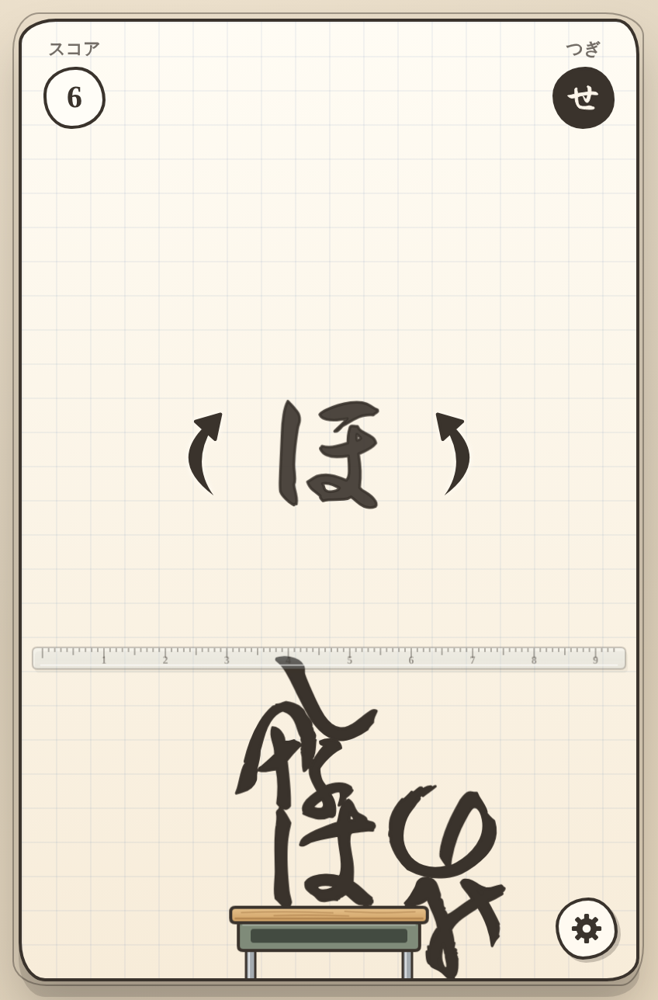

# ひらがなバランス

ひらがなを落として、たかく積み上げる物理パズルゲーム。
「手書き・文房具・紙」がテーマの、HTML ファイル 1 枚で動くブラウザゲームです。

- あそぶ（itch.io）: https://juice0402.itch.io/hiragana-balance

## あそびかた

- 画面をドラッグして文字をうごかし、指をはなすと落ちる
- 文字の左右の矢印で回転
- 落ちた文字が机（床）より下に落ちたらゲームオーバー
- 落とさずに積めた文字の数がスコア。最高記録はブラウザに保存されます

## ファイル構成

| パス | 中身 |
| --- | --- |
| `index.html` | ゲーム本体（完成版）。これ 1 枚で動く。itch.io にもこのファイルを上げる |
| `assets/icons/` | アプリアイコン案 3 種（1024×1024）。iOS では `icon_C_card.png` を使用 |
| `assets/itch/` | itch.io 用のカバー画像（630×500）とスクリーンショット 3 枚 |
| `fonts/` | 文字の形に使っているフォント Yuji Syuku と、そのライセンス（OFL） |
| `ios/ContentView.swift` | iPad の Swift Playground で iOS アプリにするためのコード |

## 公開先ごとの使い方

- **itch.io**: `index.html` をそのままアップロード（424×644、Mobile friendly・縦向き、Fullscreen ボタンあり）
- **iOS（Swift Playground）**: `index.html` を `hiragana-balance.html` という名前でアプリに追加し、`ios/ContentView.swift` を貼り付け

## クレジット

| 素材 | 作者 | ライセンス |
| --- | --- | --- |
| Yuji Syuku（文字の形） | The Yuji Project Authors | SIL Open Font License 1.1（`fonts/OFL.txt`） |
| Klee One（画面の文字） | Fontworks Inc. | SIL Open Font License 1.1（Google Fonts から読み込み） |
| Matter.js 0.20.0（物理エンジン） | Liam Brummitt and contributors | MIT License |
| poly-decomp.js（多角形の分割） | Stefan Hedman | MIT License |
| BGM | このゲームのオリジナル（ゲームの中で Web Audio で作曲・合成） | — |

ゲーム内の「クレジット」画面にも同じ内容を載せています。
